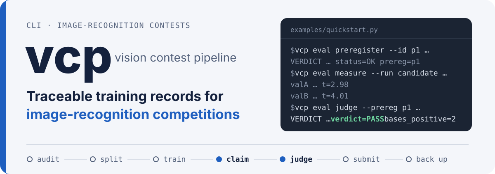
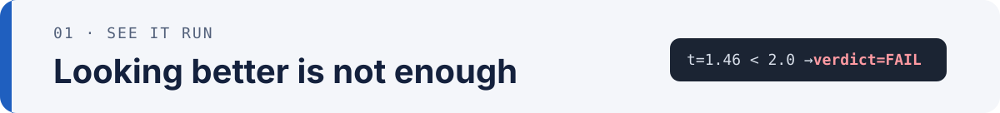
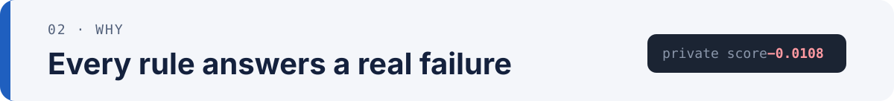
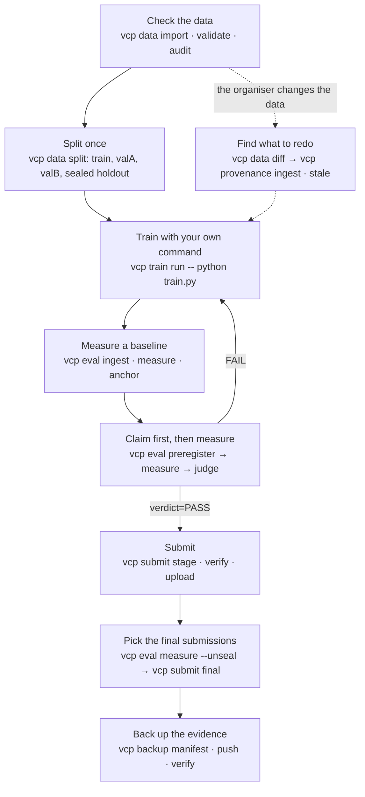
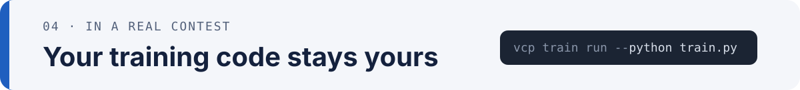

<p align="center">
  
</p>

[](https://github.com/eric20041027/Vision-contest-pipeline/actions/workflows/ci.yml)
[](CHANGELOG.md)
[](CONTRIBUTING.md)
[](https://www.python.org/downloads/)
[](LICENSE)

**English** · [繁體中文](README.zh-TW.md)

vcp is a command-line tool for people who compete in image-recognition contests on Kaggle, AIdea and similar platforms. It does not train models. You keep training with PyTorch, Ultralytics or anything else, and you run the steps around training through `vcp`: importing and splitting the data, measuring models, deciding which one to trust, submitting, and backing up.

Each of those steps leaves a record on disk that cannot be quietly edited afterwards. Every score you report can be traced back to the data, split, weights and code that produced it. The mistakes that usually decide a final rank (a leaked split, a model picked because it was measured until it won, a submission nobody can identify) are stopped by a command while there is still time to fix them.

## What you get

- **Leak checks before you split.** `vcp data audit` finds near-duplicate images and overlap between the training and test data.
- **Splits that stay fixed.** A split plan is written once. The holdout is sealed, and every opening needs a reason and is logged.
- **Claims before measurements.** You write down what a new model must beat before you measure it. `vcp eval judge` admits the model only if it wins on two independent validation subsets (the default).
- **A submission ledger.** Every upload is tied to the weights behind it. Quota and deadline are enforced, and the final pick is locked.
- **A record of what ran.** Each training run keeps a snapshot of the code it used, uncommitted files included. Training that reads data through vcp also leaves a receipt naming the subsets it touched.
- **The impact of a data change.** When the organiser re-releases the data, `vcp provenance stale` lists the runs you have to redo.
- **Backups you can check.** A backup list is generated from a result and verified file by file.
- **Friendly to scripts and AI agents.** Every command ends with one machine-readable `VERDICT` line, sets an exit code and never prompts.

## Contents

- [Try it in 60 seconds](#try-it-in-60-seconds)
- [Why vcp exists](#why-vcp-exists)
- [How it works](#how-it-works)
- [Commands](#commands)
- [What ships today](#what-ships-today)
- [What vcp does not do](#what-vcp-does-not-do)
- [Use it in a real contest](#use-it-in-a-real-contest)
- [How vcp compares](#how-vcp-compares)
- [Where it has been used](#where-it-has-been-used)
- [Status and roadmap](#status-and-roadmap)
- [Documentation](#documentation)

<p align="center">
  
</p>

## Try it in 60 seconds

You need Python 3.12 and [uv](https://docs.astral.sh/uv/).

```bash
git clone https://github.com/eric20041027/Vision-contest-pipeline && cd Vision-contest-pipeline
uv sync
uv run python examples/quickstart.py
```

The script downloads nothing and takes about a minute. It builds a 240-image synthetic dataset in a temporary directory and runs a small contest from start to finish:

1. Import, validate and split the data.
2. Record the predictions of two fake models, a baseline and a candidate.
3. Measure the baseline.
4. **Pre-register** the claim "the candidate beats the baseline on accuracy".
5. Measure the candidate and **judge** the claim.
6. Wrap a training run, delete the project directory, and verify the code snapshot that the run kept.

Every step prints the `VERDICT` line it ends with. These lines are taken from the output:

```text
VERDICT cmd=split status=OK plan=fixed-v1 train=120 valA=60 valB=60 seed=42
VERDICT cmd=eval.preregister status=OK dataset=demo prereg=p1 candidate=candidate baseline=baseline metric=accuracy subsets=valA,valB …
valA  baseline=0.6833333333333333 candidate=0.8833333333333333 delta=0.19999999999999996 t=2.98
valB  baseline=0.6833333333333333 candidate=0.9333333333333333 delta=0.25 t=4.01
VERDICT cmd=eval.judge status=OK dataset=demo prereg=p1 verdict=PASS bases_positive=2 provenance=declared
VERDICT cmd=code.verify status=OK id=code-… files=1 kept=1
```

The claim on the second line was written down before the candidate was measured. The `verdict=PASS` on the fifth line is what admits the candidate.

### Now make it fail

Open `examples/quickstart.py`, lower `CANDIDATE_ACCURACY` from `0.93` to `0.80`, and run it again:

```text
valA  baseline=0.6833333333333333 candidate=0.7333333333333333 delta=0.04999999999999993 t=0.60
valB  baseline=0.6833333333333333 candidate=0.8 delta=0.1166666666666667 t=1.46
VERDICT cmd=eval.judge status=OK dataset=demo prereg=p1 verdict=FAIL bases_positive=0 provenance=declared
```

The candidate still scores higher on both subsets, and the verdict is `FAIL`. Neither subset clears the pre-registered threshold (t ≥ 2.0), so the difference could be noise. A model that only looks better does not get in. That is the idea vcp is built around.

<p align="center">
  
</p>

## Why vcp exists

vcp grew out of a postmortem. In the 2026 AIdea marine-debris detection contest our validation set predicted the public leaderboard well. Its link to the private leaderboard was never estimated, and the most suspect part of the final ensemble was never checked outside that validation set. The private score fell by 0.0108, the largest drop among the top 16 teams.

Each rule in vcp answers a failure we could not catch that time. A command refuses, or a record shows what happened, so the outcome does not depend on anyone remembering to be careful.

| What goes wrong | What vcp does about it |
|---|---|
| **Leakage.** Validation looks great and the private leaderboard collapses. Near-duplicate images sit on both sides of the split, test images overlap the training data, or the holdout gets peeked at. | `vcp data audit` flags near-duplicates and test overlap before you split. The split plan is written once and never edited. The holdout is sealed, and each opening needs a reason, is logged and is counted at the final pick. |
| **Wishful model selection.** A candidate "wins" because it was measured until it did. | The claim is written down before the candidate is measured. `vcp eval judge` admits the candidate only if it wins on as many independent validation subsets as the claim requires, never on the best of N tries. Ensemble members are admitted one by one in the same way. |
| **Submission chaos.** Which model was submission 37? How much quota is left? Which two did you pick as final? | Every submission is staged from a pair of runs and identified by its weights hash. Staging refuses a candidate that was never admitted and a deadline that has passed. Uploads count against the quota, and everything lands in an append-only ledger. `vcp submit final` picks from sealed readings and locks the ledger. |
| **Lost evidence.** A week later nobody can rebuild the score. A teammate or an AI agent picking the work up cannot tell what was trained on what. | Every command leaves its evidence on disk. A backup manifest is generated backwards from a result and verified copy by copy. When the organiser changes the data, `vcp provenance stale` lists the runs that must be redone. |

<p align="center">
  
</p>

## How it works

### Every command ends with a verdict

```text
VERDICT cmd=eval.judge status=OK dataset=demo prereg=p1 verdict=PASS bases_positive=2 provenance=declared
```

| `status` | Exit code | Meaning |
|---|---|---|
| `OK` | 0 | The command did its work. |
| `WARN` | 0 | The command did its work, and there is something you should read. |
| `FAIL` | 1 | A check did not pass, or vcp refused the request. |
| `ABORT` | 2 | The command stopped before it could do its work, for example on a lock timeout or a nearly full disk. |

Commands never ask questions. With `--json` the result goes to stdout and the verdict to stderr, so a script or an agent can read both.

### Records are written once or only grow

- **Written once.** Split plans, pre-registrations, fusion recipes and backup manifests are never edited. To change one you create a new id, so old evidence keeps meaning what it meant.
- **Append-only.** The ledgers of readings, judgements and submissions only grow.
- **Proven, not declared.** A training loop that reads through vcp's accessor leaves a receipt naming the subsets it touched. "This model never saw the holdout" becomes something you can check.
- **The code is on record.** Each training attempt snapshots the source it uses, and a training script that uses vcp's `Session` also gets a trace of what the process imported. `vcp artifact authorize` records what a benchmark proved, and the full job is refused if its dataset, ids, code, batch or model differ.

### The steps run in a fixed order



vcp enforces the order of these gates:

1. The audit comes before a split that uses its groups.
2. A baseline reading comes before any candidate.
3. The claim comes before the candidate's first measurement.
4. `verdict=PASS` comes before a candidate is staged.
5. Stage and verify come before any upload.
6. A real upload comes before the sealed final pick.
7. A real result comes before its backup manifest.

Ensembles follow the same pattern. `vcp fuse` records the recipe, and each member has to pass its own with-it versus without-it claim. The full lifecycle with every branch is in [the visual guide](docs/guides/VCP_VISUAL_GUIDE.md).

## Commands

Each group covers one part of a contest. You can adopt one group without the rest.

| Group | What it owns | Key commands |
|---|---|---|
| `vcp data` | Dataset cards, canonical rows, split plans, entry audit, decode cache, dataset diffs | `import`, `validate`, `split`, `audit`, `export`, `materialize`, `diff` |
| `vcp eval` | Readings, guardrails, pre-registration, verdicts | `ingest`, `measure`, `anchor`, `sigma`, `preregister`, `judge`, `status`, `report` |
| `vcp fuse` | Ensemble recipes and member admission | `recipe`, `build`, `ablate` |
| `vcp train` | Wraps any training command and records what it read and produced | `run`, `upload`, `status` |
| `vcp submit` | Quota, deadline, candidate identity, final selection, lock | `init`, `stage`, `verify`, `upload`, `record`, `sync`, `final`, `select`, `status` |
| `vcp backup` | Evidence manifests generated backwards from a result, tiered push and verify | `manifest`, `push`, `verify`, `pull`, `status` |
| `vcp code` | Snapshots of the code behind a run | `snapshot`, `verify`, `diff`, `export` |
| `vcp artifact` | The immutable-artifact primitive the other groups are built on | `create`, `show`, `verify`, `lineage`, `authorize`, `status`, `clean` |
| `vcp provenance` | Which runs a dataset change affects, kept in a derived index (SQLite by default, [PostgreSQL optional](docs/guides/POSTGRESQL_PROVENANCE.md)) | `rebuild`, `sync`, `ingest`, `impact`, `stale`, `explain`, `graph`, `verify-index` |
| `vcp gc` | A disk inventory that lists large files and what refers to them. It never deletes. | `scan` |

Every option and worked flow is in [docs/reference/cli.md](docs/reference/cli.md).

## What ships today

| Axis | Built in |
|---|---|
| Tasks | classification, multi-label, regression, detection, segmentation |
| Importers | image folder, image + CSV, CSV boxes, COCO, YOLO, DICOM (multi-sequence studies), JSONL |
| Exporters | COCO, YOLO |
| Metrics | accuracy, macro AUC, macro F1, log loss, COCO mAP, mIoU, Dice, RMSE, MAE |
| Fusers | WBF, mean, rank mean |

New tasks, formats and metrics are additions. Twelve axes (task, importer, exporter, decoder, split strategy, audit, converter, metric, σ_p method, fuser, output format, platform) are registries, so adding a kind adds an entry and leaves the schema and the CLI unchanged.

Contest-specific metrics, converters, fusers and output formats register themselves from `projects/<contest>/` with `--plugin`. No contest-specific code goes into `src/vcp`.

## What vcp does not do

- **Train models.** Your training command runs unchanged inside `vcp train run`.
- **Dashboards, sweeps or AutoML.**
- **Climb the leaderboard for you.** vcp makes you slower at fooling yourself. It does not make you faster at submitting.
- **Hold credentials.** The Kaggle CLI, rclone and database connections are configured outside vcp. It refers to them by command, remote or service name and never reads their secrets.

<p align="center">
  
</p>

## Use it in a real contest

1. **Pin a version.** Make a detached worktree at a release tag and give the contest its own virtual environments, installed in editable mode against that worktree. Development on `main` can then never change a run under your feet. The exact commands are in `.claude/skills/vcp-release-and-environments`.
2. **Put contest code in `projects/<contest>/`.** A typical folder holds `prepare.py` (organiser format to `samples.jsonl`), `train.py` and `predict.py`, `metrics.py` (the official scorer, registered with `--plugin`) and a `RUNBOOK.md` that records every real id, command and verdict, failures included. If you register plugins from the folder, give it a valid Python module name such as `my_contest`.
3. **Walk the chart above** and read each verdict before the next command. [`projects/rsna-knee/`](projects/rsna-knee/) shows all of these files in place.

### Working with an AI agent

The repository ships ten skills (`.claude/skills/` for Claude Code, mirrored to `.agents/skills/` for Codex). They teach an agent the rules so it does not have to guess. For example, an agent learns not to pre-register after measuring, not to open the holdout casually, and not to stage a candidate whose verdict was `FAIL`. Load `vcp-orientation` first in any session. `vcp-running-contests` then routes to the specialist for the step you are on.

The same skills ship as the Claude Code plugin `vcp` for use in other projects:

```bash
claude plugin marketplace add eric20041027/Vision-contest-pipeline
claude plugin install vcp@vision-contest-pipeline
```

A local checkout works as a marketplace too (`claude plugin marketplace add C:/path/to/Vision-contest-pipeline`). It is loaded in place, so `git pull` updates the skills. In any project the skills answer to `/vcp:<skill>`, for example `/vcp:vcp-orientation`.

[docs/guides/AGENT_SKILLS.md](docs/guides/AGENT_SKILLS.md) lists every skill, when it fires, what it stops the agent from doing wrong, and the prompt to delegate a whole contest.

## How vcp compares

vcp sits next to the tools you already use. It does not replace them.

| Tool | What it does | What vcp adds |
|---|---|---|
| MLflow, Weights & Biases | Log runs, metrics and artifacts, and compare them in a dashboard | Decides whether a run may be admitted: a pre-registered claim, independent validation subsets, a sealed holdout whose every opening is logged |
| DVC | Versions data and pipelines | Audits the split itself (near-duplicates, test overlap), freezes it as a write-once plan, and records what training actually read |
| Kaggle CLI | Uploads and lists submissions | Ties every submission to the runs and weights behind it, enforces quota and deadline, keeps an append-only ledger and locks it at the final pick |

## Where it has been used

- **2026 AIdea marine-debris detection.** This is the contest vcp was designed from. The [postmortem](docs/postmortems/2026-08-aidea-marine-debris-detection.md) rebuilds our submission ledger from scratch, audits nineteen experiment lines against their pre-registrations, and ends with the design blueprint that became the command groups above.
- **RSNA knee abnormality detection (Kaggle, 2026).** DICOM multi-sequence studies, a 12-label macro AUC, and inference in an offline notebook. vcp ran this competition through its final day. [`projects/rsna-knee/`](projects/rsna-knee/) is the worked example, and its [RUNBOOK](projects/rsna-knee/RUNBOOK.md) records the real ids, commands and verdicts of the local baseline, failures included. The [postmortem](docs/postmortems/2026-10-rsna-knee-abnormality-detection.md) covers what vcp recorded, where the record broke, and which defects were fixed because of it.

## Status and roadmap

vcp is at `0.18.0` and has not reached 1.0. A minor version may still change what vcp writes (artifact and ledger formats) or the CLI contract, and [CHANGELOG.md](CHANGELOG.md) says what each release changed. Once you use a feature that a newer version added, an older vcp may not read the records it wrote.

- **Shipped.** All three parts of the first audit wave. The last part, code snapshots and artifact authorisation, arrived in 0.18.0.
- **Before 1.0.** The remaining follow-up items that would still change a file format, a `VERDICT` field or an exit code.
- **1.0.0.** From this release on, the artifact and ledger formats, the `VERDICT` fields and the exit codes are a promise. Changing them means a major version.
- **After 1.0.** An accessor that reads selected rows from a dataset stored as one large array, an end-to-end synthetic plugin flow, and the migration of the contest prototypes.

## Documentation

| Where | What |
|---|---|
| [docs/guides/VCP_VISUAL_GUIDE.md](docs/guides/VCP_VISUAL_GUIDE.md) | Six diagrams: the layers, the lifecycle, where evidence lives, reading a VERDICT, who decides what, a first run |
| [docs/reference/cli.md](docs/reference/cli.md) | Every command, option and worked flow |
| [docs/guides/AGENT_SKILLS.md](docs/guides/AGENT_SKILLS.md) | The ten agent skills, when each fires, and how to delegate a contest |
| [docs/guides/DATASET_EVOLUTION_PROVENANCE.md](docs/guides/DATASET_EVOLUTION_PROVENANCE.md) | What to do when the organiser changes the data |
| [docs/guides/POSTGRESQL_PROVENANCE.md](docs/guides/POSTGRESQL_PROVENANCE.md) · [docs/benchmarks/](docs/benchmarks/) | The optional PostgreSQL index: how to run it, and the measurements behind its maintenance policy |
| [docs/postmortems/](docs/postmortems/) | The two contest write-ups: marine debris, where the design came from, and RSNA knee, a full contest run on vcp |
| [docs/superpowers/specs/](docs/superpowers/specs/) | Design documents for each command group and for the rules that cut across them |
| [CONTRIBUTING.md](CONTRIBUTING.md) | Development setup, the rules the test suite enforces, how to send a change |

Most documents under `docs/` are in Traditional Chinese. The code, the CLI help and this README are in English.

## Contributing

Issues and pull requests are welcome. [CONTRIBUTING.md](CONTRIBUTING.md) has the development setup and the conventions the review gates enforce. By participating you agree to the [Code of Conduct](CODE_OF_CONDUCT.md). Security reports go through [SECURITY.md](SECURITY.md).

## License

MIT. See [LICENSE](LICENSE).
