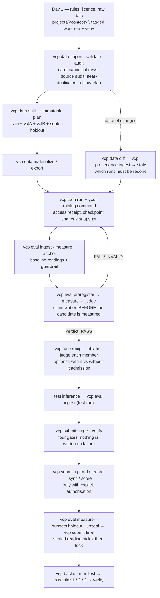

# vcp — vision contest pipeline

**Traceable training records for image-recognition competitions.**

[](https://github.com/eric20041027/Vision-contest-pipeline/actions/workflows/ci.yml)
[](CHANGELOG.md)
[](CONTRIBUTING.md)
[](https://www.python.org/downloads/)
[](LICENSE)

**Keep training your classifier, detector or segmenter with PyTorch, Ultralytics or whatever you like. vcp keeps the record around it — data splits, readings, claims, ensembles, submissions, backups — so every number you report traces back to the data, split, weights and training commit that produced it, and a leaked split or a submission nobody can trace doesn't quietly decide your final rank.**

繁體中文版：[README.zh-TW.md](README.zh-TW.md)

## The problem

You compete in Kaggle or AIdea image-recognition contests, alone or in a team, and you have seen at least one of these:

| What goes wrong | What vcp does about it |
|---|---|
| **Leakage.** Validation looks great and the private board collapses: near-duplicate images straddle the split, test images overlap the training data, the holdout gets peeked at, or the "best" model is the best of twenty tries. | `vcp data audit` flags near-duplicates and test overlap before you split. A split plan is written once and never edited; the holdout is sealed, and every opening needs a reason, is logged and is counted at the final pick. Training that reads through vcp leaves a receipt naming the subsets it touched. |
| **Wishful model selection.** A candidate "wins" because it was measured until it did. | You write the claim down *before* the candidate is measured. `vcp eval judge` admits it only if it wins on as many independent evaluation bases as the claim requires (two by default) — never on the best of N. Ensemble members are admitted one by one the same way. |
| **Submission chaos.** Which model was submission #37? How much quota is left? Which two did you pick as final? | Every submission is staged from an (eval run, test run) pair identified by its weights hash; staging refuses a candidate that was never admitted or a deadline that has passed, uploads are counted against the quota, and all of it lands in an append-only ledger. `vcp submit final` picks from sealed readings and locks the ledger. (Recording the pick you then tick on the platform arrives in 0.16.0.) |
| **Lost evidence.** A week later nobody can rebuild the score; a teammate or an AI agent picking the work up cold can't tell what was trained on what. | Every command ends with one machine-readable `VERDICT` line and leaves its evidence on disk. A backup manifest is generated backwards from a conclusion and verified copy by copy. When the organiser changes the data, `vcp provenance stale` lists the runs that must be redone. |

vcp grew out of a postmortem. In the 2026 AIdea marine-debris detection contest our validation set predicted the public board well, but its link to the private board was never estimated and the most suspect part of the final ensemble was never checked outside it — and the private board fell by 0.0108, the largest drop among the top 16 teams. Each rule above is a mechanical answer to a failure we could not catch that time: a command refuses, or a record shows what happened, instead of relying on discipline.

## 60-second demo

Requires Python 3.12 and [uv](https://docs.astral.sh/uv/).

```bash
git clone https://github.com/eric20041027/Vision-contest-pipeline && cd Vision-contest-pipeline
uv sync
uv run python examples/quickstart.py
```

One command, about a minute, no downloads: it builds a 240-image synthetic dataset in a temporary directory and walks the whole loop — import, validate, split, two fake models, ingest, measure, anchor, **pre-register**, measure, **judge**, report — printing the `VERDICT` line each step ends with. Selected lines from its output:

```text
VERDICT cmd=split status=OK plan=fixed-v1 train=120 valA=60 valB=60 seed=42
VERDICT cmd=eval.preregister status=OK dataset=demo prereg=p1 candidate=candidate baseline=baseline metric=accuracy subsets=valA,valB …
valA  baseline=0.6833333333333333 candidate=0.8833333333333333 delta=0.19999999999999996 t=2.98
valB  baseline=0.6833333333333333 candidate=0.9333333333333333 delta=0.25 t=4.01
VERDICT cmd=eval.judge status=OK dataset=demo prereg=p1 verdict=PASS bases_positive=2 provenance=declared
```

The claim on the second line was written down before the candidate was measured; the verdict on the last line is what admits it.

Now open `examples/quickstart.py`, lower `CANDIDATE_ACCURACY` to about `0.80`, and run it again. The candidate still looks better on the screen, but the verdict flips to `FAIL` because neither evaluation base clears the pre-registered threshold (t ≥ 2.0). That is the entire point of the tool.

## Goals and non-goals

**Goals**

- Every number reported in an image-recognition contest is traceable to the data, split, weights and training commit behind it. (A code snapshot for every artifact arrives with audit wave 1c.)
- The guardrails are behaviour of the commands — refusals, sealed subsets, write-once files, append-only ledgers — not a checklist you have to remember.
- New image tasks, formats and metrics are additions, not rewrites. Each of the twelve variation axes (task, importer, exporter, decoder, split strategy, audit, converter, metric, σ_p method, fuser, output format, platform) is a registry: adding a kind adds an entry, without changing the schema or the CLI.

**What ships today**

| Axis | Built in |
|---|---|
| Tasks | classification, multi-label, regression, detection, segmentation |
| Importers | image folder, image + CSV, CSV boxes, COCO, YOLO, DICOM (multi-sequence studies), JSONL |
| Exporters | COCO, YOLO |
| Metrics | accuracy, macro AUC, macro F1, log loss, COCO mAP, mIoU, Dice, RMSE, MAE |
| Fusers | WBF, mean, rank mean |

Contest-specific metrics, converters, fusers and output formats register themselves from `projects/<contest>/` with `--plugin`; no contest-specific code goes into `src/vcp`.

**Non-goals**

- Training models. Your training command runs unchanged inside `vcp train run`.
- Experiment dashboards, sweeps or AutoML.
- Climbing the leaderboard for you. vcp makes you slower at fooling yourself, not faster at submitting.
- Holding credentials. The Kaggle CLI, rclone and database connections are configured outside vcp; it refers to them by command, remote or service name and never reads their secrets.

## How it works

Every step is a command that ends with a machine-readable verdict, and the files it leaves behind are the evidence:

- **`VERDICT cmd=… status=OK|WARN|FAIL|ABORT k=v…`** ends every command (exit `0/0/1/2`; `--json` puts the result on stdout and the verdict on stderr). Commands never prompt.
- **Written-once files stay written once.** Split plans, pre-registrations, fusion recipes and backup manifests are immutable — to change one you change its id, so old evidence keeps meaning what it meant. Ledgers (readings, judgements, submissions) only grow.
- **Claims come before measurements.** A candidate is admitted only if its pre-registered claim wins on as many independent evaluation bases as the claim requires (two by default). Opening the sealed holdout takes a recorded reason, and the final pick reports how many times it was opened.
- **Reads are proven, not declared.** A training loop that reads through vcp's accessor leaves an access receipt naming the subsets it touched; "this model never saw the holdout" becomes checkable.
- **Competition code stays out of the core.** Your metrics, converters, fusers and output formats register themselves through `--plugin projects.<contest>.<module>`.



The gates cannot be reordered: audit before a split that uses its groups; a baseline reading before any candidate; the claim before the candidate's first measurement; `verdict=PASS` before a candidate is staged; stage and verify before any upload; a real upload before the sealed final; a real conclusion before its backup manifest.

## Where it has been used

- **2026 AIdea marine-debris detection** — the contest vcp was designed from. The [postmortem](docs/postmortems/2026-08-aidea-marine-debris-detection.md) rebuilds our submission ledger from scratch, audits nineteen experiment lines against their pre-registrations, and ends with the design blueprint that became the layers below.
- **RSNA knee abnormality detection (Kaggle, 2026)** — DICOM multi-sequence studies, a 12-label macro AUC, inference in an offline notebook. vcp ran this competition through its final day. [`projects/rsna-knee/`](projects/rsna-knee/) is the worked example: its [RUNBOOK](projects/rsna-knee/RUNBOOK.md) records the real ids, commands and verdicts of the local baseline, from import to the offline notebook bundle, failures included. The fixes the contest forced are in the [CHANGELOG](CHANGELOG.md).

## How vcp compares

vcp sits next to the tools you already use rather than replacing them.

| Tool | What it does | What vcp adds |
|---|---|---|
| MLflow, Weights & Biases | Log runs, metrics and artifacts; compare them in a dashboard | Decides whether a run may be admitted: a pre-registered claim, independent evaluation bases, a sealed holdout whose every opening is logged |
| DVC | Versions data and pipelines | Audits the split itself (near-duplicates, test overlap), freezes it as a write-once plan, and records what training actually read |
| Kaggle CLI | Uploads and lists submissions | Ties every submission to the runs and weights behind it, enforces quota and deadline, keeps an append-only ledger and locks it at the final pick |

## Use it for a real contest

1. **Pin a version.** Make a detached worktree at a release tag and give the contest its own venvs, editable-installed against that worktree — so development on `main` can never change a run under your feet. (`.claude/skills/vcp-release-and-environments` has the exact commands.)
2. **Put contest code in `projects/<contest>/`** (if you register plugins from it, give the folder a valid Python module name, such as `my_contest`): `prepare.py` (organiser format → `samples.jsonl`), `train.py` / `predict.py`, `metrics.py` (official scorer, registered via `--plugin`), a `RUNBOOK.md` that records every real id, command and verdict — failures included.
3. **Walk the chart above**, reading each verdict before the next command. [`projects/rsna-knee/`](projects/rsna-knee/) shows `prepare.py`, `train.py`, `predict.py` and a RUNBOOK in place.

### Working with an AI agent

The repository ships ten skills (`.claude/skills/` for Claude Code, mirrored to `.agents/skills/` for Codex) that teach an agent these rules instead of letting it guess — for example, not to pre-register after measuring, not to open the holdout casually, and not to stage a candidate whose verdict was `FAIL`. Load `vcp-orientation` first in any session; `vcp-running-contests` then routes to the specialist for the step you are on.

**In other projects**, the same skills ship as the Claude Code plugin `vcp`. Add this repository as a marketplace once — a local checkout (`claude plugin marketplace add C:/path/to/Vision-contest-pipeline`, loaded in place, so `git pull` updates the skills) or GitHub (`claude plugin marketplace add eric20041027/Vision-contest-pipeline`) — then run `claude plugin install vcp@vision-contest-pipeline`. In any project the skills answer to `/vcp:<skill>`, for example `/vcp:vcp-orientation`.

Every skill, when it fires and what it stops the agent from doing wrong, and the prompt to delegate a whole contest: [docs/guides/AGENT_SKILLS.md](docs/guides/AGENT_SKILLS.md).

## The layers

Each layer is a command group; you can adopt one without the rest.

| Group | What it owns | Key commands |
|---|---|---|
| `vcp data` | Dataset cards, canonical rows, split plans, entry audit, decode cache, dataset diffs | `import`, `validate`, `split`, `audit`, `export`, `materialize`, `diff` |
| `vcp eval` | Readings, guardrails, σ_p, pre-registration, verdicts | `ingest`, `measure`, `anchor`, `sigma`, `preregister`, `judge`, `status`, `report` |
| `vcp fuse` | Ensemble recipes and member admission | `recipe`, `build`, `ablate` |
| `vcp train` | Wraps any training command; records what it read and produced | `run`, `upload`, `status` |
| `vcp submit` | Quota, deadline, candidate identity, final selection, lock | `init`, `stage`, `verify`, `upload`, `record`, `sync`, `final`, `status` |
| `vcp backup` | Evidence manifests generated backwards from a conclusion; tiered push and verify | `manifest`, `push`, `verify`, `pull`, `status` |
| `vcp artifact` | The immutable-artifact primitive the layers above are built on | `create`, `show`, `verify`, `lineage`, `status`, `clean` |
| `vcp provenance` | Which runs a dataset change affects; a derived index (SQLite by default, [PostgreSQL optional](docs/guides/POSTGRESQL_PROVENANCE.md)) | `rebuild`, `sync`, `ingest`, `impact`, `stale`, `explain`, `graph`, `verify-index` |

Full option tables and worked flows: [docs/reference/cli.md](docs/reference/cli.md). Pictures first: [the visual guide](docs/guides/VCP_VISUAL_GUIDE.md).

## Roadmap

`0.15.1`, pre-1.0: a minor version may still change what vcp writes (artifact and ledger formats) or the CLI contract, and [CHANGELOG.md](CHANGELOG.md) says what each one changed. Once you use a feature a newer version added, an older vcp may not read the records it wrote.

1. **Lessons from RSNA (0.16.0).** Record the final selection you actually made on the platform and warn when it differs from vcp's pick; warn when the Kaggle CLI is out of date; check free disk space before training and name a full disk in the verdict.
2. **A safe clean-up report.** `vcp gc --dry-run` lists large files and what references each one; it never deletes.
3. **Audit wave 1c.** A snapshot of the code behind every artifact, and artifact authorisation.
4. **`1.0.0`**, once all of audit wave 1 (1a, 1b, 1c) has landed: from then on the artifact and ledger formats are a promise.

## Documentation

| Where | What |
|---|---|
| [docs/guides/VCP_VISUAL_GUIDE.md](docs/guides/VCP_VISUAL_GUIDE.md) | Six diagrams: the layers, the lifecycle, where evidence lives, reading a VERDICT, who decides what, a first run |
| [docs/guides/AGENT_SKILLS.md](docs/guides/AGENT_SKILLS.md) | The ten agent skills, when each fires, and how to delegate a contest |
| [docs/reference/cli.md](docs/reference/cli.md) | Every command, option and worked flow |
| [docs/guides/DATASET_EVOLUTION_PROVENANCE.md](docs/guides/DATASET_EVOLUTION_PROVENANCE.md) | What to do when the organiser changes the data |
| [docs/postmortems/](docs/postmortems/) | The marine-debris contest write-up this project came from |
| [docs/superpowers/specs/](docs/superpowers/specs/) | Design documents for each layer and for the rules that cut across them |
| [docs/guides/POSTGRESQL_PROVENANCE.md](docs/guides/POSTGRESQL_PROVENANCE.md) · [docs/benchmarks/](docs/benchmarks/) | The optional PostgreSQL index: how to run it, and the measurements behind its maintenance policy |
| [CONTRIBUTING.md](CONTRIBUTING.md) | Development setup, the rules the test suite enforces, how to send a change |

Most documents under `docs/` are in Traditional Chinese; the code, CLI help and this README are in English.

## Contributing

Issues and pull requests are welcome — see [CONTRIBUTING.md](CONTRIBUTING.md) for the development setup and the conventions the review gates enforce. By participating you agree to the [Code of Conduct](CODE_OF_CONDUCT.md). Security reports: [SECURITY.md](SECURITY.md).

## License

MIT — see [LICENSE](LICENSE).
