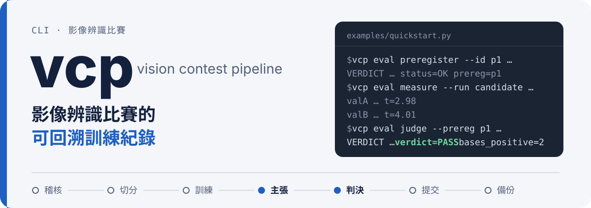
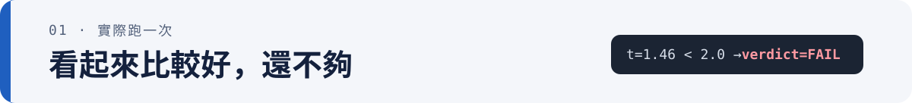
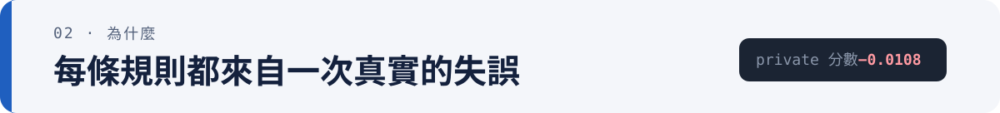
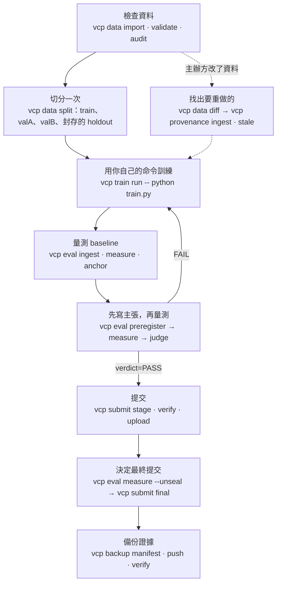
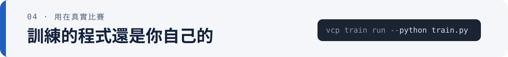

<p align="center">
  
</p>

[](https://github.com/eric20041027/Vision-contest-pipeline/actions/workflows/ci.yml)
[](CHANGELOG.md)
[](CONTRIBUTING.md)
[](https://www.python.org/downloads/)
[](LICENSE)

[English](README.md) · **繁體中文**

vcp 是一個命令列工具，給在 Kaggle、AIdea 這類平台打影像辨識比賽的人用。它不訓練模型。你照樣用 PyTorch、Ultralytics 或任何框架訓練，訓練周邊的步驟改成透過 `vcp` 來做：匯入和切分資料、量測模型、決定該相信哪一個模型、提交、備份。

每一步都會在磁碟上留下紀錄，事後沒辦法悄悄改掉。你報出來的每一個分數，都追得回產生它的資料、切分、權重和程式碼。最常決定最終名次的那幾種失誤（切分洩漏、量到贏為止才選出來的模型、沒人認得出來的提交），會在還來得及修的時候被命令擋下來。

## 你會得到什麼

- **切分之前先查洩漏。** `vcp data audit` 找出近重複的影像，以及訓練資料和測試資料的重疊。
- **切分不會再變。** 切分計畫只寫一次。holdout 是封存的，每次打開都要寫理由，也都會留紀錄。
- **先寫主張，再量測。** 新模型要贏過什麼，在量它之前就寫下來。`vcp eval judge` 只在它贏過兩個獨立的驗證子集時才准它進來（兩個是預設值）。
- **提交台帳。** 每一發上傳都綁著背後的權重。配額和截止時間由命令把關，最終選擇會上鎖。
- **跑了什麼都有紀錄。** 每次訓練都會留下當時程式碼的快照，還沒 commit 的檔案也算在內。訓練經由 vcp 讀資料時，還會留下收據，寫明它碰了哪些子集。
- **資料改版的影響。** 主辦方重新釋出資料時，`vcp provenance stale` 列出哪些 run 要重做。
- **備份可以驗證。** 備份清單從一個結果反向產生，並逐檔驗證。
- **方便腳本和 AI agent 使用。** 每個命令都以一行機器可讀的 `VERDICT` 收尾，會設定 exit code，而且從不停下來發問。

## 目錄

- [60 秒試用](#60-秒試用)
- [vcp 為什麼存在](#vcp-為什麼存在)
- [它怎麼運作](#它怎麼運作)
- [命令群](#命令群)
- [現在內建的](#現在內建的)
- [vcp 不做的事](#vcp-不做的事)
- [用在真實比賽](#用在真實比賽)
- [和其他工具的差別](#和其他工具的差別)
- [用在哪些比賽](#用在哪些比賽)
- [現況與路線圖](#現況與路線圖)
- [文件](#文件)

<p align="center">
  
</p>

## 60 秒試用

需要 Python 3.12 和 [uv](https://docs.astral.sh/uv/)。

```bash
git clone https://github.com/eric20041027/Vision-contest-pipeline && cd Vision-contest-pipeline
uv sync
uv run python examples/quickstart.py
```

這個腳本不下載任何東西，大約一分鐘跑完。它在暫存目錄產生一份 240 張合成影像的資料集，然後從頭到尾跑一場小型比賽：

1. 匯入、驗證、切分資料。
2. 記下兩個假模型的預測，一個是 baseline，一個是候選。
3. 量測 baseline。
4. **預登記**一條主張：「候選的 accuracy 贏過 baseline」。
5. 量測候選，然後**判決**這條主張。
6. 包一次訓練，刪掉專案目錄，再驗證那次訓練留下的程式碼快照。

每一步都印出收尾的 `VERDICT`。下面幾行取自實際輸出：

```text
VERDICT cmd=split status=OK plan=fixed-v1 train=120 valA=60 valB=60 seed=42
VERDICT cmd=eval.preregister status=OK dataset=demo prereg=p1 candidate=candidate baseline=baseline metric=accuracy subsets=valA,valB …
valA  baseline=0.6833333333333333 candidate=0.8833333333333333 delta=0.19999999999999996 t=2.98
valB  baseline=0.6833333333333333 candidate=0.9333333333333333 delta=0.25 t=4.01
VERDICT cmd=eval.judge status=OK dataset=demo prereg=p1 verdict=PASS bases_positive=2 provenance=declared
VERDICT cmd=code.verify status=OK id=code-… files=1 kept=1
```

第二行的主張在量測候選之前就寫下來了。第五行的 `verdict=PASS` 才是讓候選通過的東西。

### 再讓它失敗一次

打開 `examples/quickstart.py`，把 `CANDIDATE_ACCURACY` 從 `0.93` 降到 `0.80`，再跑一次：

```text
valA  baseline=0.6833333333333333 candidate=0.7333333333333333 delta=0.04999999999999993 t=0.60
valB  baseline=0.6833333333333333 candidate=0.8 delta=0.1166666666666667 t=1.46
VERDICT cmd=eval.judge status=OK dataset=demo prereg=p1 verdict=FAIL bases_positive=0 provenance=declared
```

候選在兩個子集上的分數都還是比較高，判決卻是 `FAIL`。兩個子集都沒過預登記的門檻（t ≥ 2.0），這個差距有可能只是雜訊。只是看起來比較好的模型進不來。vcp 整個工具就是圍繞這件事設計的。

<p align="center">
  
</p>

## vcp 為什麼存在

vcp 來自一份賽後報告。在 2026 AIdea 海洋廢棄物偵測比賽裡，我們的驗證集對 public 榜預測得很準。它和 private 榜的關係卻從來沒有估計過，最終融合裡最可疑的那個組件也從來沒有在這份驗證集之外檢查過。private 榜的分數掉了 0.0108，是前 16 隊裡最大的跌幅。

vcp 的每一條規則，都在回答那次沒抓到的一種失誤。命令會拒絕，或紀錄會留下發生過的事，結果就不必靠誰記得要小心。

| 出什麼錯 | vcp 怎麼處理 |
|---|---|
| **洩漏。** 驗證分數很好看，private 榜一開就垮。近重複的影像跨在切分兩邊、測試影像和訓練資料重疊，或 holdout 被偷看了。 | `vcp data audit` 在切分之前標出近重複和測試重疊。切分計畫寫一次就不再改。holdout 是封存的，每次打開都要寫理由、會留紀錄，決選時也會算進開啟次數。 |
| **一廂情願的選模。** 候選會「贏」，是因為一直量到它贏為止。 | 主張在量測候選之前就寫下來。`vcp eval judge` 只在候選贏過主張要求數量的獨立驗證子集時才准它進來，N 次裡取最好的那一次不算。融合的成員也用同樣的方式逐一審。 |
| **提交亂掉。** 第 37 發是哪個模型？配額還剩幾發？最後選了哪兩發？ | 每一發都從一組 run 配對 stage 出來，用權重的 hash 辨認身分。沒通過判決的候選、過了截止時間的提交，stage 都會拒絕。上傳會扣配額，全部寫進只增不改的台帳。`vcp submit final` 依封存子集的讀數決選，然後把台帳鎖起來。 |
| **證據散掉。** 一週後沒有人重建得出那個分數。隊友或 AI agent 接手時，看不出什麼是用什麼訓練的。 | 每個命令都把證據留在磁碟上。備份清單從一個結果反向產生，並逐份驗證副本。主辦方改了資料時，`vcp provenance stale` 列出哪些 run 要重做。 |

<p align="center">
  
</p>

## 它怎麼運作

### 每個命令都以判決收尾

```text
VERDICT cmd=eval.judge status=OK dataset=demo prereg=p1 verdict=PASS bases_positive=2 provenance=declared
```

| `status` | Exit code | 意思 |
|---|---|---|
| `OK` | 0 | 命令做完了。 |
| `WARN` | 0 | 命令做完了，但有東西需要你看一下。 |
| `FAIL` | 1 | 有一項檢查沒過，或 vcp 拒絕了這個要求。 |
| `ABORT` | 2 | 命令還沒開始做事就停下來，例如等鎖逾時或磁碟快滿了。 |

命令從不發問。加上 `--json` 時，結果進 stdout、判決進 stderr，腳本和 agent 兩邊都讀得到。

### 紀錄只寫一次，或只增不改

- **只寫一次。** 切分計畫、預登記、融合配方、備份清單寫下去就不再編輯。要改就換一個新的 id，舊的證據因此永遠是它原本的意思。
- **只增不改。** 讀數、判決、提交這三種台帳只會變長。
- **讀了什麼有憑有據。** 訓練迴圈經由 vcp 的存取器讀資料時，會留下一張收據，寫明它碰了哪些子集。「這個模型沒看過 holdout」因此可以查核。
- **程式碼有紀錄。** 每個訓練 attempt 都替它用到的原始碼做快照。訓練腳本用了 vcp 的 `Session` 時，還會留下程序實際 import 了哪些模組的追蹤。`vcp artifact authorize` 把 benchmark 證明過的東西記下來，正式 job 的資料、ids、程式碼、batch 或模型只要有一項不同就會被拒絕。

### 步驟有固定的順序



這些關卡的先後由 vcp 把關：

1. 稽核要在用到它分組結果的切分之前。
2. 先有 baseline 的讀數，才有候選。
3. 主張要在候選的第一次量測之前。
4. 先有 `verdict=PASS`，候選才能 stage。
5. stage 和 verify 要在任何上傳之前。
6. 先有一次真實的上傳，才能用封存子集決選。
7. 先有真實的結果，才有它的備份清單。

融合走同一套做法。`vcp fuse` 記下配方，每個成員都要通過自己那條「有它」對「沒有它」的主張。包含所有分支的完整流程在[視覺導覽](docs/guides/VCP_VISUAL_GUIDE.md)。

## 命令群

每個命令群負責比賽的一部分，可以只採用其中一個。

| 命令群 | 負責 | 主要命令 |
|---|---|---|
| `vcp data` | 資料卡、正規列、切分計畫、進場稽核、解碼快取、資料集差異 | `import`、`validate`、`split`、`audit`、`export`、`materialize`、`diff` |
| `vcp eval` | 讀數、護欄、預登記、判決 | `ingest`、`measure`、`anchor`、`sigma`、`preregister`、`judge`、`status`、`report` |
| `vcp fuse` | 融合配方和成員的審核 | `recipe`、`build`、`ablate` |
| `vcp train` | 包在任何訓練命令外面，記下它讀了什麼、產出什麼 | `run`、`upload`、`status` |
| `vcp submit` | 配額、截止、候選身分、決選、上鎖 | `init`、`stage`、`verify`、`upload`、`record`、`sync`、`final`、`select`、`status` |
| `vcp backup` | 從結果反向產生證據清單，分層推送和驗證 | `manifest`、`push`、`verify`、`pull`、`status` |
| `vcp code` | 每個 run 背後的程式碼快照 | `snapshot`、`verify`、`diff`、`export` |
| `vcp artifact` | 其他命令群共用的不可變產物機制 | `create`、`show`、`verify`、`lineage`、`authorize`、`status`、`clean` |
| `vcp provenance` | 資料改版會影響哪些 run，存在一份衍生索引裡（預設 SQLite，[PostgreSQL 可選](docs/guides/POSTGRESQL_PROVENANCE.md)） | `rebuild`、`sync`、`ingest`、`impact`、`stale`、`explain`、`graph`、`verify-index` |
| `vcp gc` | 磁碟盤點，列出大型檔案和誰引用它。只列不刪。 | `scan` |

每個選項和範例流程都在 [docs/reference/cli.md](docs/reference/cli.md)。

## 現在內建的

| 軸 | 內建 |
|---|---|
| 任務 | 分類、多標籤、迴歸、偵測、分割 |
| 匯入器 | 影像資料夾、影像 + CSV、CSV 框、COCO、YOLO、DICOM（多序列 study）、JSONL |
| 匯出器 | COCO、YOLO |
| 指標 | accuracy、macro AUC、macro F1、log loss、COCO mAP、mIoU、Dice、RMSE、MAE |
| 融合器 | WBF、mean、rank mean |

新的任務、格式和指標都是往上加的。十二個軸（任務、匯入器、匯出器、解碼器、切分策略、稽核、轉換器、指標、σ_p 方法、融合器、輸出格式、平台）都是登記表，多一種形態就多一個登記項，schema 和 CLI 都不用動。

比賽專屬的指標、轉換器、融合器和輸出格式，從 `projects/<contest>/` 用 `--plugin` 自行登記。比賽專屬的程式碼不進 `src/vcp`。

## vcp 不做的事

- **訓練模型。** 你的訓練命令原封不動地在 `vcp train run` 裡面跑。
- **儀表板、超參數 sweep、AutoML。**
- **幫你衝排行榜。** vcp 讓你比較難騙到自己，它不會讓你提交得更快。
- **保管憑證。** Kaggle CLI、rclone 和資料庫連線都在 vcp 之外設定。vcp 只用命令、remote 或 service 的名稱指到它們，從不讀它們的憑證或金鑰。

<p align="center">
  
</p>

## 用在真實比賽

1. **釘住版本。** 在一個 release tag 上開 detached worktree，替比賽建它自己的虛擬環境，以 editable 方式裝那個 worktree。這樣 `main` 上的開發永遠動不到正在跑的 run。確切的命令在 `.claude/skills/vcp-release-and-environments`。
2. **比賽的程式放在 `projects/<contest>/`。** 通常會有 `prepare.py`（主辦方格式轉成 `samples.jsonl`）、`train.py` 和 `predict.py`、`metrics.py`（官方計分器，用 `--plugin` 登記），以及一份 `RUNBOOK.md`，記下每個真實的 id、命令和判決，失敗的也留著。要從這個資料夾登記 plugin 的話，資料夾名稱必須是合法的 Python 模組名，例如 `my_contest`。
3. **照上面那張圖走**，每個命令先讀判決再下一個。[`projects/rsna-knee/`](projects/rsna-knee/) 可以看到這些檔案實際的樣子。

### 讓 AI agent 幫忙

repo 內建十個 skill（Claude Code 讀 `.claude/skills/`，Codex 讀鏡射的 `.agents/skills/`）。它們把規則教給 agent，agent 就不用猜。例如 agent 會學到不在量完之後才預登記、不隨手打開 holdout、不把判決是 `FAIL` 的候選 stage 上去。任何 session 先讀 `vcp-orientation`，再由 `vcp-running-contests` 依你所在的步驟轉到專用的 skill。

同一組 skill 也做成了 Claude Code plugin `vcp`，可以在別的專案使用：

```bash
claude plugin marketplace add eric20041027/Vision-contest-pipeline
claude plugin install vcp@vision-contest-pipeline
```

本機的 checkout 也可以當 marketplace（`claude plugin marketplace add C:/path/to/Vision-contest-pipeline`）。它是原地載入的，所以 `git pull` 就會更新 skill。之後在任何專案都用 `/vcp:<skill>` 呼叫，例如 `/vcp:vcp-orientation`。

[docs/guides/AGENT_SKILLS.md](docs/guides/AGENT_SKILLS.md) 列出每個 skill、它的觸發時機、它擋掉 agent 的哪種錯，以及委派整場比賽用的 prompt。

## 和其他工具的差別

vcp 和你已經在用的工具並排使用，不取代它們。

| 工具 | 它做什麼 | vcp 多給你什麼 |
|---|---|---|
| MLflow、Weights & Biases | 記錄 run、指標和產物，在儀表板上比較 | 判定一個 run 能不能通過：預登記的主張、獨立的驗證子集、每次打開都留紀錄的封存 holdout |
| DVC | 版控資料和 pipeline | 稽核切分本身（近重複、測試重疊），把它凍結成只寫一次的計畫，並記下訓練實際讀了什麼 |
| Kaggle CLI | 上傳和列出提交 | 把每一發綁回背後的 run 和權重，把關配額和截止時間，台帳只增不改，決選時上鎖 |

## 用在哪些比賽

- **2026 AIdea 海洋廢棄物偵測。** vcp 就是根據這場比賽設計的。[賽後報告](docs/postmortems/2026-08-aidea-marine-debris-detection.md)從頭重建我們的提交台帳，逐條對照十九條實驗線的預登記，最後一章的設計藍圖就是上面這些命令群的來源。
- **RSNA 膝關節異常偵測（Kaggle，2026）。** DICOM 多序列 study、12 個標籤的 macro AUC、離線 notebook 推論。vcp 一路用到比賽最後一天。[`projects/rsna-knee/`](projects/rsna-knee/) 是實際案例，它的 [RUNBOOK](projects/rsna-knee/RUNBOOK.md) 記下本機基準的真實 id、命令和判決，失敗的也留著。[賽後報告](docs/postmortems/2026-10-rsna-knee-abnormality-detection.md)寫了 vcp 記到了什麼、紀錄在哪裡斷掉，以及因此修掉了哪些缺陷。

## 現況與路線圖

vcp 目前是 `0.18.0`，還沒到 1.0。MINOR 版仍然可能改變 vcp 寫出的內容（產物和台帳的格式）或 CLI 契約，每一版改了什麼都寫在 [CHANGELOG.md](CHANGELOG.md)。用了新版才有的功能之後，舊版的 vcp 可能讀不了那些紀錄。

- **已完成。** 第一波稽核的三個部分都已經發出。最後一部分是程式碼快照和產物授權，在 0.18.0。
- **1.0 之前。** 還會改到檔案格式、`VERDICT` 欄位或 exit code 的剩餘待辦。
- **1.0.0。** 從這一版起，產物和台帳的格式、`VERDICT` 欄位和 exit code 都是對外的承諾，要改就是 MAJOR 版。
- **1.0 之後。** 一個能從單一大陣列形式的資料集裡讀取指定列的存取器、一條合成 plugin 的端到端流程，以及比賽原型的遷移。

## 文件

| 位置 | 內容 |
|---|---|
| [docs/guides/VCP_VISUAL_GUIDE.md](docs/guides/VCP_VISUAL_GUIDE.md) | 六張圖：分層架構、完整生命週期、證據位置、怎麼讀 VERDICT、人和 agent 的分工、第一次跑通 |
| [docs/reference/cli.md](docs/reference/cli.md) | 每個命令、每個選項和範例流程 |
| [docs/guides/AGENT_SKILLS.md](docs/guides/AGENT_SKILLS.md) | 十個 agent skill、各自的觸發時機、怎麼委派一場比賽 |
| [docs/guides/DATASET_EVOLUTION_PROVENANCE.md](docs/guides/DATASET_EVOLUTION_PROVENANCE.md) | 主辦方改了資料時怎麼辦 |
| [docs/guides/POSTGRESQL_PROVENANCE.md](docs/guides/POSTGRESQL_PROVENANCE.md) · [docs/benchmarks/](docs/benchmarks/) | 可選的 PostgreSQL 索引：怎麼跑，以及它的維護策略背後的量測 |
| [docs/postmortems/](docs/postmortems/) | 兩份賽後報告：海洋廢棄物（設計的起點）和 RSNA 膝關節（用 vcp 跑完的一整場比賽） |
| [docs/superpowers/specs/](docs/superpowers/specs/) | 各命令群和跨層規則的設計文件 |
| [CONTRIBUTING.md](CONTRIBUTING.md) | 開發環境、測試把關的規則、怎麼送出變更 |

`docs/` 底下的文件大多是繁體中文。程式碼、CLI help 和英文 README 是英文。

## 參與

歡迎開 issue 和 pull request。開發環境和審查的慣例寫在 [CONTRIBUTING.md](CONTRIBUTING.md)。參與即表示同意[行為準則](CODE_OF_CONDUCT.md)。安全性問題請依 [SECURITY.md](SECURITY.md) 回報。

## 授權

MIT，見 [LICENSE](LICENSE)。
