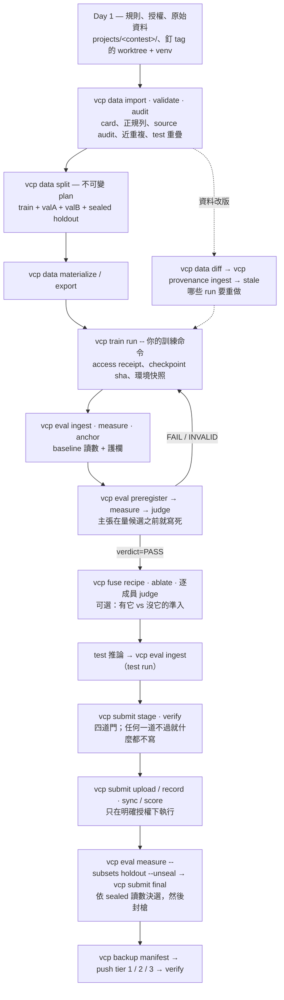

# vcp — vision contest pipeline

**影像辨識比賽的可回溯訓練紀錄。**

[](https://github.com/eric20041027/Vision-contest-pipeline/actions/workflows/ci.yml)
[](CHANGELOG.md)
[](CONTRIBUTING.md)
[](https://www.python.org/downloads/)
[](LICENSE)

**你的分類、偵測或分割模型繼續用 PyTorch、Ultralytics 或任何框架訓練。vcp 負責模型周邊的紀錄——切分、讀數、主張、融合、提交、備份——讓你報出來的每一個數字都追得回產生它的那份資料、那個切分、那個權重與那次訓練的 commit，最後的名次不會在不知不覺間被一次洩漏的切分或一發追不回來的提交決定。**

English: [README.md](README.md)

## 要解決的問題

你在 Kaggle 或 AIdea 打影像辨識比賽，單打或組隊，至少碰過下面其中一種：

| 出什麼錯 | vcp 怎麼處理 |
|---|---|
| **洩漏。** 驗證分數很好看，private 榜一開就垮：近重複的圖跨在切分兩邊、test 圖和訓練資料重疊、holdout 被偷看，或「最好的」模型其實是二十次裡挑最好的一次。 | `vcp data audit` 在切分前抓出近重複與 test 重疊。切分計畫寫一次就不再改；holdout 封存，每次打開都要寫理由、會留紀錄，決選時也會算進開啟次數。經 vcp 讀資料的訓練會留下收據，寫明它碰了哪些子集。 |
| **一廂情願的選模。** 候選會「贏」，是因為一直量到它贏為止。 | 主張在量測候選**之前**就寫下來。`vcp eval judge` 只在它贏過主張要求數量的獨立評估基底（預設兩個）時才準入——永遠不是 N 次取最好。融合成員也用同樣的方式逐一準入。 |
| **提交亂掉。** 第 37 發是哪個模型？配額還剩幾發？最後勾了哪兩發當 final？ | 每一發都從一組 (eval run, test run) 配對 stage，身分靠權重 hash；沒準入的候選或過了截止時間，stage 直接拒絕，上傳時扣配額，全部寫進只增不改的台帳。`vcp submit final` 依 sealed 讀數決選並封槍。（記錄你之後在平台上實際勾選的那幾發，0.16.0 才會有。） |
| **證據散掉。** 一週後沒人重建得出那個分數；隊友或 AI agent 冷接手，看不出什麼是用什麼訓練的。 | 每個命令都以一行機器可讀的 `VERDICT` 收尾，並把證據留在磁碟上。備份清單從結論反向生成、逐檔驗證。主辦方改了資料時，`vcp provenance stale` 列出哪些 run 要重做。 |

vcp 來自一份賽後報告。在 2026 AIdea 海洋廢棄物偵測比賽裡，我們的驗證集對 public 榜預測得很準，但它和 private 榜的關係從來沒估計過，最終融合裡最可疑的那個組件也從沒在驗證集之外檢查過——結果 private 榜掉了 0.0108，是前段 16 隊裡最大的跌幅。上面每一條規則，都是對那次沒抓到的失誤給出的機械式回答：由命令拒絕，或由紀錄留下發生過的事，而不是靠自律。

## 60 秒 demo

需要 Python 3.12 與 [uv](https://docs.astral.sh/uv/)。

```bash
git clone https://github.com/eric20041027/Vision-contest-pipeline && cd Vision-contest-pipeline
uv sync
uv run python examples/quickstart.py
```

一條命令、約一分鐘、不下載任何東西：它在暫存目錄生成 240 張合成影像的資料集，走完整個迴圈——import、validate、split、兩個假模型、ingest、measure、anchor、**preregister**、measure、**judge**、report——每一步印出收尾的 `VERDICT`。輸出節錄：

```text
VERDICT cmd=split status=OK plan=fixed-v1 train=120 valA=60 valB=60 seed=42
VERDICT cmd=eval.preregister status=OK dataset=demo prereg=p1 candidate=candidate baseline=baseline metric=accuracy subsets=valA,valB …
valA  baseline=0.6833333333333333 candidate=0.8833333333333333 delta=0.19999999999999996 t=2.98
valB  baseline=0.6833333333333333 candidate=0.9333333333333333 delta=0.25 t=4.01
VERDICT cmd=eval.judge status=OK dataset=demo prereg=p1 verdict=PASS bases_positive=2 provenance=declared
```

第二行的主張在量測候選之前就寫死；最後一行的判決才是準入。

接著打開 `examples/quickstart.py`，把 `CANDIDATE_ACCURACY` 降到 `0.80` 左右再跑一次。候選在螢幕上仍然看起來比較好，但判決翻成 `FAIL`，因為兩個評估基底都沒過預登記的門檻（t ≥ 2.0）。這就是這個工具的全部意義。

## 目標與不做的事

**目標**

- 影像辨識比賽裡報出的每一個數字，都追得回背後的資料、切分、權重與訓練的 commit。（每個產物都附程式碼快照，要等稽核 Wave 1c。）
- 防呆是命令本身的行為——拒絕、封存子集、寫一次的檔、只增不改的台帳——不是一張要你自己記得的檢查表。
- 新的影像任務、格式與指標是「加上去」，不是「改寫」。十二個變異軸（任務、匯入器、匯出器、解碼器、切分策略、稽核、轉換器、指標、σ_p 方法、融合器、輸出格式、平台）都是登記表：多一種形態就多一個登記項，不改 schema、不改 CLI。

**現在內建的**

| 軸 | 內建 |
|---|---|
| 任務 | 分類、多標籤、迴歸、偵測、分割 |
| 匯入器 | 影像資料夾、影像 + CSV、CSV 框、COCO、YOLO、DICOM（多序列 study）、JSONL |
| 匯出器 | COCO、YOLO |
| 指標 | accuracy、macro AUC、macro F1、log loss、COCO mAP、mIoU、Dice、RMSE、MAE |
| 融合器 | WBF、mean、rank mean |

比賽專屬的指標、轉換器、融合器與輸出格式，從 `projects/<contest>/` 以 `--plugin` 自行登記；比賽專屬的程式碼不進 `src/vcp`。

**不做的事**

- 訓練模型。你的訓練命令原封不動地在 `vcp train run` 裡面跑。
- 實驗儀表板、超參數 sweep 或 AutoML。
- 幫你衝排行榜。vcp 讓你比較難騙自己，不是讓你更快提交。
- 保管憑證。Kaggle CLI、rclone 與資料庫連線都在 vcp 之外設定；vcp 只用命令、remote 或 service 名稱指到它們，從不讀它們的憑證或金鑰。

## 它怎麼運作

每一步都是一個以機器可讀判決收尾的命令，留下的檔案就是證據：

- **每個命令以 `VERDICT cmd=… status=OK|WARN|FAIL|ABORT k=v…` 收尾**（exit `0/0/1/2`；`--json` 時結果進 stdout、判決進 stderr）。命令永不互動提問。
- **寫一次的檔就不再改。** 切分計畫、預登記、融合配方、備份清單都不可變——要改就換 id，舊證據因此永遠還是它原本的意思。台帳（讀數、判決、提交）只增不改。
- **主張先於量測。** 候選只有在預登記的主張贏過它要求數量的獨立評估基底（預設兩個）才準入。打開 sealed holdout 要留下理由，決選時會列出它被打開過幾次。
- **讀取是證明出來的，不是宣告的。** 訓練迴圈經 vcp 的存取器讀資料時會留下收據，寫明它碰了哪些子集；「這個模型沒看過 holdout」因此可以查核。
- **比賽專屬程式碼不進核心。** 你的指標、轉換器、融合器與輸出格式以 `--plugin projects.<contest>.<module>` 自行登記。



閘門不能倒置：`audit` 先於用它分組的 split；baseline 先有讀數再有候選；主張先於候選的第一次量測；`verdict=PASS` 先於候選 stage；stage / verify 先於任何上傳；真實上傳先於 sealed 決選；真實結論先於它的備份清單。

## 用在哪些比賽

- **2026 AIdea 海洋廢棄物偵測**——vcp 據以設計的那場比賽。[賽後報告](docs/postmortems/2026-08-aidea-marine-debris-detection.md)從頭重建我們的提交台帳、逐條對證十九條實驗線的預登記，最後一章的設計藍圖就是下面這幾層。
- **RSNA 膝關節異常偵測（Kaggle，2026）**——DICOM 多序列 study、12 標籤 macro AUC、離線 notebook 推論。vcp 一路用到比賽最後一天。[`projects/rsna-knee/`](projects/rsna-knee/) 是實際案例：[RUNBOOK](projects/rsna-knee/RUNBOOK.md) 記下本機基準從匯入到離線 notebook bundle 的真實 id、命令與判決，失敗也留著。這場比賽逼出來的修正都寫在 [CHANGELOG](CHANGELOG.md)。

## 和其他工具的差別

vcp 和你已經在用的工具並排使用，不是取代它們。

| 工具 | 它做什麼 | vcp 多給你什麼 |
|---|---|---|
| MLflow、Weights & Biases | 記錄 run、指標與產物，在儀表板上比較 | 判定一個 run 能不能準入：預登記的主張、獨立的評估基底、每次打開都留紀錄的 sealed holdout |
| DVC | 版控資料與 pipeline | 稽核切分本身（近重複、test 重疊），把它凍結成寫一次的計畫，並記下訓練實際讀了什麼 |
| Kaggle CLI | 上傳與列出提交 | 把每一發綁回背後的 run 與權重，執行配額與截止，台帳只增不改，決選時封槍 |

## 用在真實比賽

1. **釘住版本。** 在 release tag 開一個 detached worktree，比賽的 venv 以 editable 指向它——`main` 上的開發永遠動不到跑中的 run（`.claude/skills/vcp-release-and-environments` 有確切命令）。
2. **比賽程式放 `projects/<contest>/`**（要從這裡登記 plugin 的話，資料夾名稱必須是合法的 Python 模組名，例如 `my_contest`）：`prepare.py`（主辦方格式 → `samples.jsonl`）、`train.py` / `predict.py`、`metrics.py`（官方計分器，以 `--plugin` 登記）、`RUNBOOK.md`（記下每個真實 id、命令與判決——失敗也留）。
3. **照上面那張圖走**，每個命令先讀判決再下一個。[`projects/rsna-knee/`](projects/rsna-knee/) 可以看到 `prepare.py`、`train.py`、`predict.py` 與 RUNBOOK 怎麼擺。

### 讓 AI agent 幫忙

repo 內建十個 skill（Claude Code 讀 `.claude/skills/`，Codex 讀鏡射的 `.agents/skills/`），讓 agent 學到這些規則而不是猜——例如不在量完之後才預登記、不隨手開 holdout、不把判決是 `FAIL` 的候選 stage 上去。任何 session 先讀 `vcp-orientation`，再由 `vcp-running-contests` 依你所在的步驟轉到專用 skill。

**在別的專案用**：同一組 skill 也是 Claude Code plugin `vcp`。先把這個 repo 加成 marketplace（只要一次）——本機 checkout（`claude plugin marketplace add C:/path/to/Vision-contest-pipeline`，原地載入，`git pull` 就更新 skill）或 GitHub（`claude plugin marketplace add eric20041027/Vision-contest-pipeline`）——再執行 `claude plugin install vcp@vision-contest-pipeline`。之後在任何專案用 `/vcp:<skill>` 呼叫，例如 `/vcp:vcp-orientation`。

每個 skill 的觸發時機、它擋掉 agent 的哪種錯，以及委派整場比賽的 prompt：[docs/guides/AGENT_SKILLS.md](docs/guides/AGENT_SKILLS.md)。

## 八層

每一層是一個命令群，可以只採用其中一層。

| 命令群 | 負責 | 主要命令 |
|---|---|---|
| `vcp data` | 資料卡、正規列、切分計畫、進場稽核、解碼快取、資料集差異 | `import`、`validate`、`split`、`audit`、`export`、`materialize`、`diff` |
| `vcp eval` | 讀數、護欄、σ_p、預登記、判決 | `ingest`、`measure`、`anchor`、`sigma`、`preregister`、`judge`、`status`、`report` |
| `vcp fuse` | 融合配方與成員準入 | `recipe`、`build`、`ablate` |
| `vcp train` | 包在任何訓練命令外面，記錄它實際讀了什麼、產出什麼 | `run`、`upload`、`status` |
| `vcp submit` | 配額、截止、候選身分、決選與封槍 | `init`、`stage`、`verify`、`upload`、`record`、`sync`、`final`、`status` |
| `vcp backup` | 從結論反向生成證據清單，分層推送與驗證 | `manifest`、`push`、`verify`、`pull`、`status` |
| `vcp artifact` | 上面各層共用的不可變產物原語 | `create`、`show`、`verify`、`lineage`、`status`、`clean` |
| `vcp provenance` | 資料改版會影響哪些 run；衍生索引（預設 SQLite，[PostgreSQL 可選](docs/guides/POSTGRESQL_PROVENANCE.md)） | `rebuild`、`sync`、`ingest`、`impact`、`stale`、`explain`、`graph`、`verify-index` |

完整選項表與範例流程：[docs/reference/cli.md](docs/reference/cli.md)。想先看圖：[視覺導覽](docs/guides/VCP_VISUAL_GUIDE.md)。

## 路線圖

`0.15.1`，尚未到 1.0：MINOR 版仍可能改寫入格式（產物與台帳）或 CLI 契約，每次改了什麼寫在 [CHANGELOG.md](CHANGELOG.md)；用到新版加的功能之後，舊版 vcp 可能讀不動新紀錄。

1. **RSNA 的教訓（0.16.0）。** 記錄你在平台上實際勾選的最終提交，和 vcp 的決選不同時警告；Kaggle CLI 過舊時警告；訓練前檢查磁碟空間，磁碟滿時在判決裡寫明原因。
2. **安全的清理報告。** `vcp gc --dry-run` 列出大型檔案與每一個被誰引用；只列不刪。
3. **稽核 Wave 1c。** 每個產物背後的程式碼快照，以及產物授權。
4. **`1.0.0`**，等稽核 Wave 1（1a、1b、1c）全部落地：從那之後，產物與台帳格式就是對外的承諾。

## 文件

| 位置 | 內容 |
|---|---|
| [docs/guides/VCP_VISUAL_GUIDE.md](docs/guides/VCP_VISUAL_GUIDE.md) | 六張圖：分層架構、完整生命週期、證據位置、怎麼讀 VERDICT、人與 agent 的分工、第一次跑通 |
| [docs/guides/AGENT_SKILLS.md](docs/guides/AGENT_SKILLS.md) | 十個 agent skill、各自的觸發時機、怎麼委派一場比賽 |
| [docs/reference/cli.md](docs/reference/cli.md) | 每個命令、每個選項與範例流程 |
| [docs/guides/DATASET_EVOLUTION_PROVENANCE.md](docs/guides/DATASET_EVOLUTION_PROVENANCE.md) | 主辦方改了資料時怎麼辦 |
| [docs/postmortems/](docs/postmortems/) | 這個專案的起點：海洋廢棄物比賽的賽後報告 |
| [docs/superpowers/specs/](docs/superpowers/specs/) | 各層與跨層規則的設計文件 |
| [docs/guides/POSTGRESQL_PROVENANCE.md](docs/guides/POSTGRESQL_PROVENANCE.md) · [docs/benchmarks/](docs/benchmarks/) | 可選的 PostgreSQL 索引：怎麼跑，以及它維護策略背後的量測 |
| [CONTRIBUTING.md](CONTRIBUTING.md) | 開發環境、測試門檻與送出變更的方式 |

`docs/` 底下大多是繁體中文；程式碼、CLI help 與英文 README 是英文。

## 參與

歡迎開 issue 與 pull request——開發設定與審查門檻見 [CONTRIBUTING.md](CONTRIBUTING.md)。參與即表示同意[行為準則](CODE_OF_CONDUCT.md)。安全性回報：[SECURITY.md](SECURITY.md)。

## 授權

MIT，見 [LICENSE](LICENSE)。
